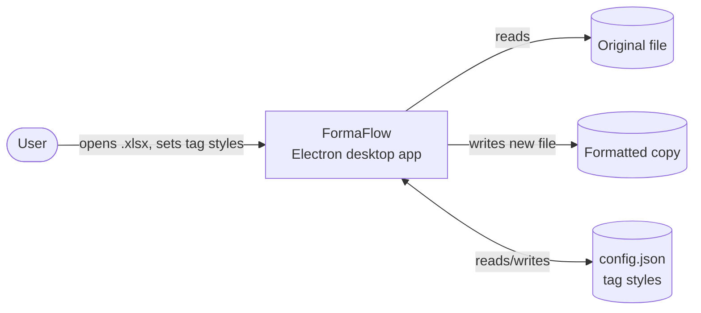
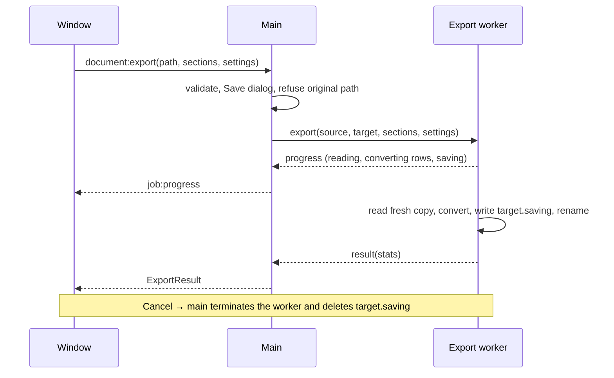

# Software Architecture Document

Last reviewed: 2026-11-09 · Authoritative for structure and boundaries · Decisions: [ADRs](adr/README.md)

## 1. Context

A desktop app reads a document whose text contains HTML tags (`<b>`, `<i>`, `<sup>`…), lets the user choose a style
per tag, and writes a **new** file where the tags became real formatting. It runs fully offline on Windows and macOS.
There is no server and no database; the only stored data is the tag-style settings file
([settings schema](../data/settings-schema.md)).



## 2. Packages and dependency rules

```mermaid
flowchart TB
  app[apps/excel-formatter<br/>composition root] --> ui[@hf/ui]
  app --> desktop[@hf/desktop]
  app --> xl[@hf/adapter-excel]
  ui --> core[@hf/core]
  desktop --> core
  xl --> core
  xl --> exceljs[(ExcelJS)]
```

| Package                | Responsibility                                                                                                                                                                         | Runs in                       |
| ---------------------- | -------------------------------------------------------------------------------------------------------------------------------------------------------------------------------------- | ----------------------------- |
| `@hf/core`             | Tokenizer, HTML → styled runs, tag scanning, settings validation, style descriptions, shared types, `FormatAdapter`, `FormatInfo`                                                      | Everywhere (pure)             |
| `@hf/adapter-excel`    | `.xlsx`: read, summarise sheets, preview grid data, convert cells to rich text, safe write. `./format` = browser-safe `excelFormat` and preview types                                  | Worker (`./format`: window)   |
| `@hf/desktop`          | `./main`: window, IPC handlers, dialogs, settings file, jobs, crash dialogs · `./worker`: runs a `FormatAdapter` · `./preload`: `window.api` bridge                                    | Main process, worker, preload |
| `@hf/ui`               | React window: routes and guards (TanStack Router), screens (pages), zustand store, design system by Atomic Design level in `src/design/` ([ADR 0011](adr/0011-atomic-design-in-ui.md)) | Window (renderer)             |
| `apps/excel-formatter` | Wires format + adapter + preview component; app icon; packaging; e2e tests                                                                                                             | All (as bundles)              |

**Dependency rules** (enforced by ESLint, `tools/lint/config.js`):

- Dependencies point down only: apps → ui / desktop / adapters → core. Nothing imports an app.
- `core` imports nothing from Electron, Node, React, libraries or other `@hf/*`.
- The window (`@hf/ui`, app renderer) never imports Electron, Node, ExcelJS, `@hf/desktop` or adapter entry points
  (only `@hf/adapter-excel/format`).
- The preload imports only `electron` at runtime.
- `@hf/desktop` imports no React and no format adapter — formats are injected by the app.

## 3. Runtime view

Four execution contexts, isolated from each other:

```mermaid
flowchart LR
  subgraph Window[Window — sandboxed renderer]
    UI[@hf/ui screens<br/>router + store]
  end
  subgraph Preload[Preload — sandboxed]
    API[window.api]
  end
  subgraph Main[Main process]
    IPC[IPC handlers<br/>dialogs, settings, jobs]
  end
  subgraph Workers[Worker threads]
    S[Session worker<br/>open document + previews]
    E[Export worker<br/>one per save, killed on Cancel]
  end
  UI -->|calls| API -->|ipcRenderer.invoke| IPC
  IPC -->|requests| S & E
  S & E -->|progress, result| IPC -->|job:progress events| API --> UI
```

Sequence of a save (export):



## 4. Window: routes, state, composition

| Address                                                                                  | Screen                                    | Guard                                                         |
| ---------------------------------------------------------------------------------------- | ----------------------------------------- | ------------------------------------------------------------- |
| `#/`                                                                                     | Home (file type, action, Continue)        | —                                                             |
| `#/upload`                                                                               | Step 3: Upload                            | the workflow is started (from Home, a template or Open again) |
| `#/configure?tab=tags&section=`                                                          | Step 4: Configure (Sheets / Tag Styles)   | needs an open document                                        |
| `#/preview/$section?view=formatted\|original`                                            | Step 5: Preview (side by side by default) | needs a selection; unknown section → first selected           |
| `#/check/$section?cell=&saved=`                                                          | Step 5: the compare screen                | same as preview                                               |
| `#/complete`                                                                             | Step 6: Export & complete                 | needs a selection, or a clean save just made                  |
| `#/workspace`, `#/recent`, `#/favorites`, `#/templates`, `#/preferences`, `#/automation` | Sidebar pages                             | —                                                             |
| `#/settings?tag=&back=`                                                                  | Formatting Profiles (tag styles)          | — (`back` must be an in-app path)                             |
| `#/help`, `#/help/$topic?section=`                                                       | Help Center                               | —                                                             |

- The router owns **where the user is**; the zustand store (`packages/ui/src/state/store.ts`) owns **data**: open document
  summary, selection, settings, running job, previews, export result.
- Each app supplies its `FormatInfo` (labels, file types) and a `Preview` component through React context
  (`mountFormatterApp(root, { format, Preview })`).

## 5. Quality attributes and how they're met

| Attribute      | Approach                                                                                                                  |
| -------------- | ------------------------------------------------------------------------------------------------------------------------- |
| Responsiveness | All file work in worker threads; progress throttled; grid memoised ([ADR 0003](adr/0003-worker-threads-for-file-work.md)) |
| Safety of data | Original never overwritten; writes go to a temporary file then rename; settings validated                                 |
| Security       | Sandbox, context isolation, CSP, IPC validation, file allow-list, no HTML rendering ([security](../security.md))          |
| Extensibility  | `FormatAdapter` + composition roots ([ADR 0006](adr/0006-format-adapter-and-composition-root.md))                         |
| Testability    | Pure core; adapters tested with real files; e2e with Playwright ([testing strategy](../testing-strategy.md))              |
| Portability    | Electron 45 on Windows and macOS; hash routing for `file://`                                                              |

## 6. Known limits and planned evolution

- `FormatAdapter` reads and writes the same format. Export to other formats needs a reader → neutral document model →
  writer pipeline with a format registry (roadmap Phase 3, needs decision D1).
- `@hf/desktop`'s IPC handlers have low unit-test coverage (covered by e2e for now); Phase 2 splits them into
  testable modules. `@hf/ui`'s components are unit-tested since the Atomic Design change (ADR 0011); screens are
  covered by e2e.
- ExcelJS doesn't keep charts, pivot tables or macros ([ADR 0005](adr/0005-exceljs-for-xlsx.md)).
