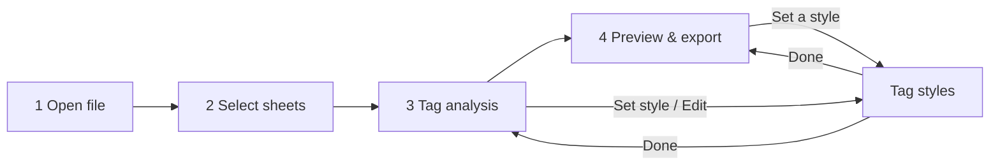

# Functional Design Specification

Last reviewed: 2026-11-09 · Authoritative for **how features behave**. Requirements: [SRS](../requirements/SRS.md).
Test references: `e2e:` = `apps/excel-formatter/e2e/smoke.spec.ts`; `unit:` = package tests.

## Workflow

## F0. Home (FR-25, FR-26)

The start screen ([ADR 0013](../architecture/adr/0013-recent-activity.md)):

- **Start:** "Continue with <file>" (only when a file is open; returns to the last document screen visited) and the
  format's open card ("Choose a file…" opens the dialog, then Select sheets).
- **Coming soon:** Convert to PDF, Word and text, shown as unavailable (disabled button "Not available yet"); listed in
  `EXPORT_TARGETS` (`screens/Dashboard.tsx`).
- **Tools:** Tag styles.
- **Recent activity:** the last 10 opens and saves, newest first: file name, what happened (saves: source file, items
  formatted, saved-file check result), folder, time. **Open again** opens the Open dialog in that folder; **Clear**
  empties the list (kept across restarts).

**Acceptance:** e2e "starts on Home…" and "Home lists recent activity…"; unit `ui/tests/dashboard.test.tsx`,
`desktop/tests/activity.test.ts`.

## F1. Open file (FR-01, FR-02, FR-09)

- Click the drop area for the Open dialog (filtered to `.xlsx`), or drop a file on it.
- While the file is read, a panel shows "Opening <name>", the stage, a progress bar and **Cancel**.
- On success → **Select sheets**. On failure → an error banner explaining what to do (file missing, locked, damaged or
  not a real `.xlsx`). On Cancel → back to Open with "Stopped opening <name>".
- Opening another file closes the previous one.

**Acceptance:** non-`.xlsx` drops are refused (unit: `adapter-excel/tests/excel.test.ts` errors; desktop
`file:describe`). Starting state has the other steps locked (e2e: "starts on Open…").

## F2. Select sheets (FR-03)

- Table: checkbox, sheet name (+ "Hidden" chip), size (`rows × columns`), HTML cells, the first 8 tags (+ "N more").
- Visible sheets with HTML are pre-selected. A hint mentions hidden sheets that contain HTML.
- "Select all" checkbox; clicking a row toggles it. **Analyse tags →** is disabled with no selection.

**Acceptance:** sample workbook shows "5 sheets… 3 contain HTML and are selected for you" (e2e full flow).

## F3. Tag analysis (FR-04)

- One tab per selected sheet; a tab shows a warning count of tags with no style.
- Totals: cells with HTML, different tags, tag uses, tags with no style.
- Table per tag: uses, first cell, style description ("Styled · Bold · 14 pt"), "Built in" for `br`/`p`, "No style" for
  unconfigured tags, a preview of the first cell, and **Edit** / **Set style**.
- A banner lists tags with no style and what will happen to them.

**Acceptance:** unit tests for scanning and descriptions; e2e opens Science and sets a style for ``.

## F4. Tag styles (FR-05, FR-06)

- List of tags (rules + tags used in the open file); unconfigured ones are flagged.
- Editor: B / I / U / S toggles, font color, font size, font, position (normal/super/sub), live preview on sample text
  and on a real cell. **Keep text plain** creates an empty rule. **Remove style** deletes it.
- Add a tag by name (`mark`, `<H1>` → `h1`); built-in `br`/`p` can't be styled.
- Setting: tags with no style → remove the tag (keep text) or keep the tag as text.
- **Export JSON… / Import JSON… / Reset to defaults** (reset asks for confirmation).
- Every change saves automatically. Opened from another screen, a **Done, back to …** button returns there.

**Business rules:** validation per [settings schema](../data/settings-schema.md). **Acceptance:** unit
`validateConfig.test.ts`; e2e "Keep text plain" then Done.

## F5. Preview & export (FR-07, FR-08, FR-09, FR-10)

- Totals: sheets to convert, cells to format, tags with no style (with banner).
- Per-sheet tabs; **Formatted / Original HTML** switch; Excel-style grid (first 200 rows × 30 columns, with a note
  when larger).
- **Save formatted file…** opens a Save dialog (default `<name>_formatted.xlsx`). Progress panel with Cancel.
- Success box: "N cells formatted in M sheets, K set to wrap text", tags removed/kept, "Your original file was not
  changed", **Show in folder**.
- A note next to Save says charts, pivot tables and macros aren't copied.

**Business rules:** see TDS §2 (conversion rules). **Acceptance:** e2e full flow checks the saved file's rich text and
wrap text, and that the original is unchanged; e2e overwrite refusal; e2e Cancel leaves no file; unit
`convert.test.ts`.

## F6. Navigation (FR-11)

Addresses, guards and search parameters: [SAD §4](../architecture/SAD.md#4-window-routes-state-composition).
The app starts on Home (`#/`); the sidebar's **Home** link returns there. A reload loses the open document and
returns to Open. **Acceptance:** unit `ui/tests/router.test.ts`; e2e reload test.

## F7. Errors and messages (NFR-08)

Every error says what happened and what to do; a dismissible red banner at the top. Cancellations aren't errors
(shown as a short toast).
