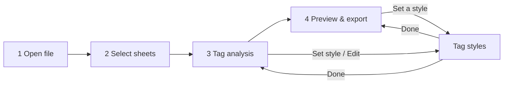

# Functional Design Specification

Last reviewed: 2026-11-09 · Authoritative for **how features behave**. Requirements: [SRS](../requirements/SRS.md).
Test references: `e2e:` = `apps/excel-formatter/e2e/smoke.spec.ts`; `unit:` = package tests.

## Workflow

## F00. Startup (FR-30)

The window opens straight onto a startup screen: the mark, "FormaFlow", "Starting…" and a bar that shows work is going
on (no percentage: the time is unknown and usually very short). It is plain HTML in the app's `index.html`, so it shows
before the app's code runs, in the saved theme. The app then loads the settings and app details ("Loading your
settings…", same look) and opens Home as soon as they arrive, with no added delay. If they can't be read, the screen
says so with the reason and **Try again**. Recent activity and the theme don't hold up or fail start-up.
**Acceptance:** e2e "start-up: a failure…"; unit `ui/tests/startup.test.tsx`; the mark's shapes are checked against
`icon.svg` (`atoms.test.tsx`).

## F0. Home (FR-25, FR-26)

The start screen ([ADR 0013](../architecture/adr/0013-recent-activity.md)):

- **Layout ("Blue Shiny Wave" prototype):** "Welcome to FormaFlow" over a decorative wave and file pictures; a "How
  it works" bar (Select file type, Choose action, Process & export; numbers fill as choices are made, the current
  part has `aria-current="step"`); two columns below 1320 px become one, in the order step 1, step 2, Quick actions.
- **Choose what to do:** **Step 1: Select file type** (Excel, Word, PDF, Text cards: a labelled page picture, the
  name, the extensions and a short description; the app's own type lists only what it really opens, `.xlsx`),
  **Step 2: Choose an action** for that type, then **Continue** under the actions, which opens the Open screen. The
  line beside Continue says "Available now: …" or why nothing can be started. Types and actions come from
  `features/workflow/registry.ts`; an action is selectable only when the running app implements it (Format HTML tags
  for Excel), the others show **Coming soon** and can't be chosen. A type with no ready action leaves Continue disabled
  and says so. Both groups are radio groups (arrow keys, Home and End move between enabled cards). The choice is kept
  while the app runs.
- **Quick actions:** Open recent (moves to Recent activity below), Formatting Profiles (Tag styles), Help & guides.
- **Resume:** "You're working on <file>" with **Continue →** (only when a file is open; returns to the last document
  screen visited).
- **Workflow lock (FR-29):** the sidebar's four workflow steps, and their addresses, are locked until the workflow is
  started from Home: **Continue**, **Open** in recent activity, or **Continue →** on the open file. Going Home
  mid-workflow keeps it unlocked.
  A clean save ends it (see F5); typed addresses of locked screens go to Home.
- **After a clean save:** the save summary (below) is shown at the top of Home, with **Show in folder** and a close
  button, until closed or the next workflow starts.
- **Tag styles** is reached from **Formatting Profiles** in the sidebar (the old Tools card is gone).
- **Recent activity:** the last 10 opens and saves, newest first, one row each: file name and folder, status as
  recorded (Opened, Formatted, Saved with differences, Saved, not checked; the full description is the status's
  tooltip), time, and **Open** ("Open again from <folder>" for screen readers), which opens the Open dialog in that
  folder. **Clear** empties the list (kept across restarts).

**Acceptance:** e2e "starts on Home…" and "Home lists recent activity…"; unit `ui/tests/dashboard.test.tsx`, `ui/tests/home.test.tsx`,
`desktop/tests/activity.test.ts`.

## F0b. Header and theme (FR-27)

A header bar above every screen holds **Theme: Light / Dark / System** (a radio group). System follows the operating
system live. The choice applies at once to the window, dialogs and menus, is remembered, and the next start opens in
it ([ADR 0014](../architecture/adr/0014-theme-preference.md)). **Acceptance:** e2e "the theme choice applies…";
unit `ui/tests/theme.test.ts`, `ui/tests/tokens.test.ts` (contrast), `desktop/tests/preferences.test.ts`.

## F0c. Help Center (FR-28)

**Help** in the header (and a card on Home) opens `#/help`: a search box and the topics (Getting started, User guide,
FAQs, Troubleshooting, About). Typing searches titles, headings and text; each result names the topic and section,
with an excerpt and the words highlighted; the count is announced. A topic page (`#/help/$topic`) lists its sections,
then the text; links to other topics open them at the right section. About adds the version, platform and settings
file. Web addresses are shown, not opened ([ADR 0015](../architecture/adr/0015-help-center-markdown.md)).
**Acceptance:** e2e "Help: topics by keyboard…"; unit `ui/tests/help.test.tsx`, router test for `?q` and `?section`.

## F1. Open file (FR-01, FR-02, FR-09)

- Click the drop area for the Open dialog (filtered to `.xlsx`), or drop a file on it.
- While the file is read, a panel shows "Opening <name>", the stage, a progress bar and **Cancel**.
- On success → **Select sheets**. On failure → an error banner explaining what to do (file missing, locked, damaged or
  not a real `.xlsx`). On Cancel → back to Open with "Stopped opening <name>".
- Opening another file closes the previous one.

**Acceptance:** non-`.xlsx` drops are refused (unit: `adapter-excel/tests/excel.test.ts` errors; desktop
`file:describe`). Starting state has the other steps locked (e2e: "starts on Open…").

## F2. Select sheets (FR-03)

- Table: checkbox, sheet name (+ "Hidden" chip), size (`rows × columns`), HTML cells, the first 8 tags (+ "N more").
- Visible sheets with HTML are pre-selected. A hint mentions hidden sheets that contain HTML.
- "Select all" checkbox; clicking a row toggles it. **Analyse tags →** is disabled with no selection.

**Acceptance:** sample workbook shows "5 sheets… 3 contain HTML and are selected for you" (e2e full flow).

## F3. Tag analysis (FR-04)

- One tab per selected sheet; a tab shows a warning count of tags with no style.
- Totals: cells with HTML, different tags, tag uses, tags with no style.
- Table per tag: uses, first cell, style description ("Styled · Bold · 14 pt"), "Built in" for `br`/`p`, "No style" for
  unconfigured tags, a preview of the first cell, and **Edit** / **Set style**.
- A banner lists tags with no style and what will happen to them.

**Acceptance:** unit tests for scanning and descriptions; e2e opens Science and sets a style for ``.

## F4. Tag styles (FR-05, FR-06)

- List of tags (rules + tags used in the open file); unconfigured ones are flagged.
- Editor: B / I / U / S toggles, font color, font size, font, position (normal/super/sub), live preview on sample text
  and on a real cell. **Keep text plain** creates an empty rule. **Remove style** deletes it.
- Add a tag by name (`mark`, `<H1>` → `h1`); built-in `br`/`p` can't be styled.
- Setting: tags with no style → remove the tag (keep text) or keep the tag as text.
- **Export JSON… / Import JSON… / Reset to defaults** (reset asks for confirmation).
- Every change saves automatically. Opened from another screen, a **Done, back to …** button returns there.

**Business rules:** validation per [settings schema](../data/settings-schema.md). **Acceptance:** unit
`validateConfig.test.ts`; e2e "Keep text plain" then Done.

## F5. Preview & export (FR-07, FR-08, FR-09, FR-10)

- Totals: sheets to convert, cells to format, tags with no style (with banner).
- Per-sheet tabs; **Formatted / Original HTML** switch; Excel-style grid (first 200 rows × 30 columns, with a note
  when larger).
- **Save formatted file…** opens a Save dialog (default `<name>_formatted.xlsx`). Progress panel with Cancel.
- Success box: "N cells formatted in M sheets, K set to wrap text", tags removed/kept, "Your original file was not
  changed", **Show in folder**.
- **Clean save** (no known issues, and the saved file matches or its check was stopped): the file is closed, the
  workflow ends and Export & complete shows the success box (FR-29, F8). **Save with problems** (saved with known
  issues, or the saved file has differences): the file stays open so the review can be opened.
- A note next to Save says charts, pivot tables and macros aren't copied.

**Business rules:** see TDS §2 (conversion rules). **Acceptance:** e2e full flow checks the saved file's rich text and
wrap text, and that the original is unchanged; e2e overwrite refusal; e2e Cancel leaves no file; unit
`convert.test.ts`.

## F8. Redesigned workflow and pages (FR-31 – FR-37)

From the "Reference-Matched (Horizontal Steps)" prototype (roadmap P1–P15). F1–F5 above describe what each step
does; this is where it now lives.

- **Six steps** (`WorkflowTemplate`): a full-width stepper (`WorkflowStepper`: done steps green with a tick and a link
  back, the current one blue with `aria-current="step"`), the screen, the **Workflow summary** (`WorkflowSummary`:
  file type, action, extensions, file, selected sheets, profile, and the guarantees that are really kept), and Back /
  Continue with "Your original file is never changed".
- **Upload** (`#/upload`, F1): drop zone with the file type's picture, **Choose file**, supported formats; the chosen
  file with its size and sheet count, **Remove**; **Load sample** (ADR 0017). The file stays here until Continue.
- **Configure** (`#/configure`, F2 + F3): a Sheets / Tag Styles switcher (`?tab=tags&section=X`). Sheets: the sheet
  table with Select all. Tag Styles: **Active profile** picker, per-sheet tabs, the tag table with Set style / Edit.
  Continue opens the preview of the sheet shown.
- **Preview** (`#/preview/X`, F5): `ProcessingPanel` (ring and the six real stages; a percentage only when the stage
  reports counts), **Content verification** (`VerificationPanel`: Passed / Needs review / Checking… / Not checked, from
  the real check), **Side by side** (default) / Formatted / Original HTML. The compare screen (`#/check/X`) belongs
  to this step.
- **Export & complete** (`#/complete`): **Output name** (the Save dialog's starting name), what will be saved, **Save
  formatted file…** with the processing panel and Cancel. After a clean save: **Processing completed!**, the
  summary (file, action, sheets processed, cells formatted, saved as, saved-file check), **Open file** (ADR 0017),
  **Show in folder**, **New task**.
- **My Workspace** (`#/workspace`): New workflow, Recent files, Profiles; the active task ("Step x of 6") with
  **Resume workflow**; the latest 5 files. The sidebar marks My Workspace **Active** while a task is open.
- **Recent Files** (`#/recent`) and **Favorites** (`#/favorites`): rows with file, folder, status, time, **Open**
  (dialog in that folder) and a star; **Clear** asks first and keeps Favorites.
- **Formatting Profiles** (`#/settings`): `ProfileManager` (Use, Rename, Duplicate, Delete, Create) above the tag
  editor for the active profile (ADR 0018).
- **Templates** (`#/templates`): list with Use / Delete and a form (name, action, profile, sheets to tick).
- **Settings** (`#/preferences`), **Automation (Beta)** (`#/automation`, a "planned" notice), **Search** in the
  header (combobox, Ctrl+K).

**Acceptance:** e2e "starts on Home" (sidebar pages, search, Upload with Load sample and Remove), "open → analyse →
… export" (Configure, Preview, Export with output name, Complete), "Home: Continue mid-workflow…" (Workspace,
Favorites, Clear asks first), "Formatting Profiles" (profiles, Configure's picker, a template), "Help" (search finds
a help topic); unit tests in `ui/tests` (steps, processing, search, store) and `desktop/tests` (favorites, profiles,
templates, ipcChecks).

## F6. Navigation (FR-11)

Addresses, guards and search parameters: [SAD §4](../architecture/SAD.md#4-window-routes-state-composition).
The app starts on Home (`#/`); the sidebar's **Home** link returns there. A reload loses the open document and
returns to Home with the workflow locked. **Acceptance:** unit `ui/tests/router.test.ts`; e2e reload test.

## F7. Errors and messages (NFR-08)

Every error says what happened and what to do; a dismissible red banner at the top. Cancellations aren't errors
(shown as a short toast).
