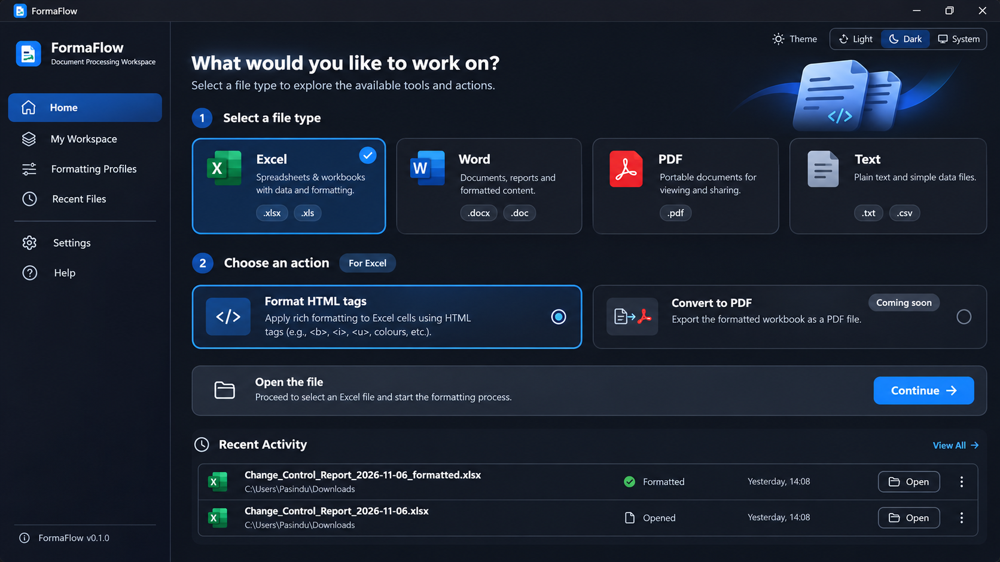
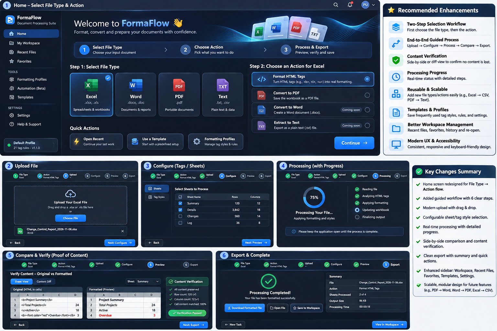

# FormaFlow — Claude Implementation Master Guide

> **Purpose:** Implement a faithful, production-quality redesign of the **existing FormaFlow desktop application** using the supplied screen references. This document is an executable development brief for Claude Code or another coding agent operating inside the real project repository. Do **not** create an unrelated demo or rewrite an application from scratch. First audit the project, then reuse its actual stack, routes, state, conversion engine, and file APIs.
>
> **Priority:** (1) preserve functioning Excel HTML formatting and data safety, (2) reproduce reference design closely, (3) implement correct end-to-end interactions, (4) establish modular scalability for other file types.
>
> **Important:** The reference PNGs are AI-generated visual mockups, not source code. Some labels, demo rows, file sizes, percentages, time estimates and decorative features are illustrative, not verified app behavior. Build _design fidelity_, but never manufacture processing/verification results or claim unsupported capability.

## 0. How to use this brief in Claude Code

1. Copy the entire `FormaFlow-Claude-Redesign/` folder into the project, preferably `docs/design/FormaFlow-Claude-Redesign/`.
2. Open Claude Code **at the repository root**, so it can inspect and modify the existing app.
3. Ask Claude: **“Read `docs/design/FormaFlow-Claude-Redesign/CLAUDE_IMPLEMENTATION_GUIDE.md` and all reference images. Follow the audit-first implementation plan; show the audit and proposed file changes before editing. Implement in small, testable phases, maintaining visual fidelity and existing functionality.”**
4. Give Claude permission to use your repository and existing test/build commands, but require review before risky dependency changes, destructive operations, or data migrations.
5. Keep this guide in `docs/design/` as the UI implementation contract. Add a short link to it from the existing README.

### Required companion reference images

| Reference                                                                                    | Purpose                                                                                   | Priority    |
| -------------------------------------------------------------------------------------------- | ----------------------------------------------------------------------------------------- | ----------- |
| [`references/00-original-current.png`](references/00-original-current.png)                   | Existing app baseline; preserve functioning features and familiar product identity        | Context     |
| [`references/01-home-action-selection.png`](references/01-home-action-selection.png)         | **Primary Home screen** reference: file type → action → continue → recent activity        | **Highest** |
| [`references/02-home-recent-files.png`](references/02-home-recent-files.png)                 | Alternative Home design: search bar, recent-files table, larger file-type selection cards | High        |
| [`references/03-upload-guided-workspace.png`](references/03-upload-guided-workspace.png)     | **Primary Upload screen**: six steps, upload panel, task summary and bottom navigation    | **Highest** |
| [`references/04-upload-summary-alternate.png`](references/04-upload-summary-alternate.png)   | Alternative Upload composition: summary card, privacy strip, step navigation              | Medium      |
| [`references/05-complete-screen-blueprint.png`](references/05-complete-screen-blueprint.png) | Multi-screen blueprint: Home, Upload, Configure, Processing, Compare/Verify, Export       | **Highest** |





**Conflict resolution:** Use `01` for Home composition, `03` for Upload composition and `05` for Configure/Processing/Compare/Export. Use `02` for recent-file table polish and `04` for supporting upload details. This instruction resolves differences across concept images. Consistent components are more important than literal differences between mockups.

---

## 1. Non-negotiable implementation instructions for Claude

- **Audit before coding:** inspect project manifest(s), framework, desktop shell (if any), routing, styling approach, assets, icons, state management, tests, build/deployment scripts, file ingestion and HTML tag processing code.
- **No premature rewrite:** keep the existing language, component framework, desktop integration and backend. Reorganize files incrementally only if safe. Do not migrate Electron/Tauri/web frameworks merely because they appear in this brief.
- **Maintain behavior:** existing Excel selection, sheet selection, HTML tag analysis, configurable tag rules, formatting, saving, source-file protection, history and theme modes must continue to work.
- **Don't fake features:** Word, PDF and TXT _source types_ may be shown for discoverability, but display `Coming soon` for actions that are not implemented. Clearly distinguish input type from conversion output. Never enable a button that does nothing.
- **Respect real capabilities:** confirm `.xls` handling, drag and drop, supported tags, input limits, progress hooks, file size caps and output formats in code. Do not hard-code speculative constraints from images.
- **Local processing claim:** show “processed locally” only after confirming actual implementation. Do not claim encryption, privacy controls or retention rules that are not implemented.
- **Save safely:** never overwrite the original silently. Use explicit destination, collision handling, writable-folder checks and verified save results.
- **Verify truthfully:** verification is a real deterministic comparison and should show pass/fail/unknown, not unconditional green checks or hard-coded “100% match”. Document coverage and limitations.
- **Preserve accessibility:** keyboard access, focus indicators, reduced motion, semantic controls, zoom, status announcements and contrast.
- **Show progress in phases:** after each phase, report changed files, visual differences, test results, remaining limitations and screenshot evidence where possible.
- **Do not copy demo personally identifying strings** (user name, source file paths etc.) into production fixtures; use generic samples.

### Audit deliverable before modifying code

Produce `docs/design/formaflow-audit.md` with:

1. Actual stack and entry points.
2. Existing route/page/component map.
3. Existing feature status: what is live, partial or planned.
4. How backend processing, tag rules, sheet selection, save and verification work.
5. Existing design tokens/styles and dependency choices.
6. Risks, backwards-compatibility concerns and incremental migration proposal.
7. File-by-file implementation plan, tagged **create / modify / keep**.

Then begin coding one phase at a time. If automation allows, take a baseline screenshot first.

---

## 2. Product design principles

The new Home focuses on **input file type first**, **available action second**, **open file third**. Subsequent steps are tailored to the selected action.

**Main flow:** `Home: File Type → Action → Upload → Configure → Process → Compare & Verify → Export → Complete`.

The Home screen should not masquerade as a partially finished workflow. Global navigation remains in the outer sidebar. When inside a workflow, show a contextual stepper/sidebar inside the workspace. Avoid duplicating the same six-step navigation in multiple competing locations.

**Design adjectives:** premium, practical, modern Windows desktop utility, trustworthy, visually calm, technical, polished, consistent, responsive, accessible. Follow the images' deep navy/charcoal surfaces, electric blue primary accents, green verification accents, and softly bordered cards.

**Density guidance:** desktop-first, but responsive down to narrow windows without clipping. Prioritize visible work controls and clear typography over excessive empty space. Avoid decorative gradients that overpower functional content.

---

## 3. Visual system — colors, spacing, typography, components

### 3.1 Design tokens

These are **implementation target colors approximated from supplied image references**, not exact digital color measurements. Centralize tokens in existing theme system and calibrate visually against screenshots after implementation.

```css
:root[data-theme='dark'] {
  --ff-app-bg: #0b1320;
  --ff-window-bg: #0e1624;
  --ff-sidebar-bg: #0c1421;
  --ff-surface: #151f2e;
  --ff-surface-raised: #1a273a;
  --ff-surface-hover: #21334e;
  --ff-border: #324157;
  --ff-border-muted: #26364a;
  --ff-text: #f5f8ff;
  --ff-text-secondary: #a8bed8;
  --ff-text-muted: #8195ad;
  --ff-primary: #2586ff;
  --ff-primary-hover: #1472eb;
  --ff-primary-soft: #12315b;
  --ff-primary-border: #3797ff;
  --ff-success: #20c878;
  --ff-success-soft: #0d4030;
  --ff-warning: #f2b84b;
  --ff-warning-soft: #493719;
  --ff-error: #f2676d;
  --ff-error-soft: #492328;
  --ff-focus: #80baff;
  --ff-shadow: 0 12px 36px rgb(0 0 0 / 22%);
  --ff-radius-xs: 6px;
  --ff-radius-sm: 9px;
  --ff-radius-md: 12px;
  --ff-radius-lg: 16px;
  --ff-radius-xl: 20px;
  --ff-space-1: 4px;
  --ff-space-2: 8px;
  --ff-space-3: 12px;
  --ff-space-4: 16px;
  --ff-space-5: 20px;
  --ff-space-6: 24px;
  --ff-space-8: 32px;
  --ff-space-10: 40px;
  --ff-sidebar-width: 252px;
  --ff-panel-width: 290px;
}
```

Apply an equivalent **light-theme token set** through the existing theme architecture: light slate page background, white cards, dark navy text, blue primary, same semantic green/yellow/red, accessible contrast. **System theme** should follow OS preferences; use explicit `Light | Dark | System` toggle like the screenshots.

### 3.2 Typography

- Prefer an existing bundled font if licensed/available; otherwise `Inter`, `Segoe UI Variable`, `Segoe UI`, system UI, sans-serif. Do not redistribute proprietary font files.
- Hero heading 30–36px / 700–750; page heading 26–30px / 700; card heading 17–20px / 650–700; section heading 17–19px / 650; body 14–16px / 400–500; captions 12–13px / 400–500.
- Use a stable type scale and accessible line heights (body about 1.45–1.6). Avoid all-caps except small navigation section labels.

### 3.3 Layout and spacing

- Desktop window: reference approximately 1672 × 941. Test at 1920×1080, 1440×900, 1280×800, 1024×768 and narrow app windows.
- Sidebar: width 240–260px; full-height; thin right border; logo/name top; nav body; profile/version bottom.
- Content padding: 28–36px desktop, 18–24px intermediate, 12–16px compact.
- Cards: 1px border, 12–16px radius, 16–24px internal padding, subtle raised background.
- Primary buttons: ~42–46px tall, blue fill/hover, white label, 9–12px radius, clear disabled state.
- Action selection: blue border and faint blue-tinted fill; completed step: green circular icon; unselected: muted outline.
- Header/topbar: ~60–72px, app branding and breadcrumbs on left, `Help`, theme toggle and optional working search on right.
- Scroll inside the main content when needed; sidebar remains stable. Never make bottom actions inaccessible when window shrinks.
- Decorative abstract blue wave is **optional** and should be achieved with restrained CSS/SVG; keep contrast/text readable. Avoid slicing giant screenshots into UI elements.

### 3.4 UI states

Every interactive element must have **default / hover / focus-visible / selected / disabled / loading / error** states as appropriate. Include skeletons or compact loading indicators only when actual loading is occurring. Respect `prefers-reduced-motion`.

Recommended icon family: the **existing icon library** where possible; otherwise a single consistent line-icon set (e.g. Lucide if already installed or approved). Use recognizable Excel/Word/PDF/Text glyphs; avoid licensing or trademark misuse.

---

## 4. Information architecture and navigation

### Global sidebar

```text
FormaFlow
Document Processing Workspace

Home
My Workspace
Recent Files
Formatting Profiles

Settings
Help & Support

Footer: active profile • rule count • app version
```

Only show `Favorites`, `Templates`, and `Automation` if actually implemented. Otherwise omit or explicitly mark future capabilities. Do not populate unrelated dummy menu items.

### Contextual wizard sidebar (inside an active workspace)

```text
Workflow: [selected action]
1  File type      [selected / completed]
2  Action         [selected / completed]
3  Upload         [active / completed]
4  Configure      [active / completed]
5  Process        [active / completed]
6  Review         [active / completed]
7  Export         [active / completed]
```

**Important resolution:** Mockups disagree on whether there are six or seven steps and whether processing is separate. Use a **registry-defined workflow step array** rather than a globally fixed number. Recommended implementation: six visible stages inside the workspace where **File type + Action = context**, and **Upload → Configure → Process → Compare & Verify → Export** are shown as the guided journey. Alternatively a seven-step stepper is acceptable if consistent across all screens. The specific step count must derive from the selected feature and its real implementation; do not show non-applicable steps (e.g. sheet selection for PDF).

---

## 5. Screen specifications

### Screen A — Home: source type → action (PRIMARY `01`, support `02`)

**Purpose:** Let the user select what kind of file they have and what they want to do, before choosing the actual file.

**Visual composition**

1. Sidebar at left, compact topbar at top.
2. Main hero: `What would you like to work on?` + subtitle `Select a file type to explore the available tools and actions.`; optional blue decorative artwork in the far-right area.
3. `Step 1 — Select a file type`: four equally sized cards across desktop: Excel, Word, PDF, Text, with extension pills. Selected card gets blue border/glow and check circle.
4. `Step 2 — Choose an action`: action list **filters based on selected input type**. Radio-style select. Show `Coming soon` on unavailable actions. Only enable the actual supported actions.
5. Continue strip with chosen file type/action and prominent blue **Continue** button, enabled only when valid.
6. Compact `Recent activity` section with realistic records from actual application data. Include filename, location (privacy-safe if configured), time, real status and meaningful `Open` / `Reopen` control. If no records, display a pleasant empty state.

**For Excel:** Show `Format HTML tags` as enabled **only if supported in current code**. Other potential actions (Convert to PDF/Word/CSV, extract text) are **planned** until implemented. For Word/PDF/Text, list only confirmed implemented actions; otherwise display disabled options and informative description, without dead-end navigation.

**Critical behavior:** Type selection updates the action list, clears incompatible selections, and retains logical context. Reload behavior should restore only valid cached state if supported. Both pointer and keyboard interactions work.

### Screen B — Upload (PRIMARY `03`, support `04`)

**Purpose:** Select valid source file and understand the task.

**Visual composition**

- Breadcrumb: `Home / Workspace / Excel / Format HTML tags`.
- Page heading: `Upload your Excel file`.
- Center: large dashed blue dropzone with document illustration/icon, `Drag and drop your file here`, secondary `or browse from your computer`, and blue **Choose file** button.
- Right: `Task summary` card with actual selected type, action, accepted extensions, steps and configured options. **Do not display fake estimated processing times.**
- Bottom: `Back` and `Continue` sticky action bar (only if it doesn't cover content).
- Secondary panel: `What happens next?` with short explanation.

**Behavior:** Native file picker + drag/drop (if supported by desktop shell). Validate extension, signature/content where feasible, access, password/encryption, corruption, locked files, size **only according to real constraints**. Display selected file details, replace/remove option and specific errors. Don't upload to a server unless the existing workflow requires it. Continue only when file is acceptable.

### Screen C — Configure (`05`)

**Purpose:** Provide scoped, safe processing settings.

- Top working step indicator and title `Configure formatting`.
- Left compact tabs: `Sheets` and `Tag styles`.
- Sheets tab: searchable table with **name, row count, column count, selected checkbox**, Select All / Deselect All, real sheet list, disabled/unavailable indicators if applicable.
- Tag styles tab: show available HTML tag rules from existing configuration; color, font weight, italic, underline, font size, and supported attributes as implemented.
- Preview of an example formatting rule with original HTML text and visual result.
- `Use profile` selector, `Save as profile` only if persistent profiles are actually supported; warn on overwrites.
- Preserve source cell contents and formulas as guaranteed by underlying engine; don't promise lossless transformations where engine cannot deliver.
- Next button disabled if invalid/no selected sheets.

### Screen D — Process with live progress (`05`)

- Heading `Processing your file` and relevant source filename.
- Visual progress indicator/circle **only when progress is measurable**. Otherwise indeterminate animation with current stage.
- Stage list e.g. `Reading file`, `Analyzing HTML`, `Applying formatting`, `Writing output`, `Verifying output` — mapped to actual engine events.
- Real-time counts when available: sheets analyzed, candidate cells, formatted cells, warnings; avoid fake 75% demo values.
- Clear retryable vs non-retryable error state and logs/details. Prevent duplicate starts. Handle cancellation only if supported safely.
- For long operations, keep UI responsive; offload blocking work according to real architecture. Preserve the original at all times.

### Screen E — Compare & Verify (`05`)

**This is a release-critical screen.** Title `Review changes` and descriptive subtitle `Compare original content with formatted output before saving.`

- Two side-by-side panes: **Original (HTML/source)** and **Formatted preview**.
- Sheet selector if Excel; synced row/column positions, sticky headers where feasible.
- Tabs: `Sheet view`, `Changes`, `Verification`, perhaps `Warnings`.
- Highlight modified cells; use semantic colors for text/style changes; preserve original and transformed render modes.
- Summary panel with real metrics: source sheet count, destination sheet count, selected sheets, evaluated cell count, matched values, detected differences, warnings, unsupported objects, formatting adjustments.
- **Integrity checks**: workbook/sheet structure (if required), cell values vs expected post-processing values, formulas, data types, merged regions and relevant metadata as supported. Differentiate `pass`, `fail`, `not checked` for each check.
- Document expected transformations: e.g. HTML source tags become styled content in target; do not compare raw strings naively to transformed displayed text and call that “lost content”. Compare normalized expected text and relevant properties.
- If results are too large, virtualize sample rows, allow search for changed/error cells, summarize total checks and disclose sampled vs exhaustive verification.
- Show `Verification passed` **only** if actual required checks succeed. Failed checks must be clearly presented and export must follow documented safety rules (block on critical failures, allow acknowledgment for noncritical warnings if appropriate).

### Screen F — Export & Complete (`05`)

- Before save: output filename preview, destination picker, available output format (only actual supported), `Keep original unchanged`, overwrite behavior, explicit save action.
- During save: disable duplicate save, show real stage.
- After success: a green check mark, `Processing complete`, real output path, size and counts, verification status and concise summary.
- Actions: `Open file`, `Open folder`, `Start new task` (only as supported by desktop shell). `Save to Workspace` only if that concept truly exists.
- Failure states: permission denied, file already exists, disk full, invalid path, unable to verify saved file; preserve recovery/retry pathways.

### Screen G — My Workspace & Recent Files

- Search/filter by filename, file type, date, status and action; sort by most recent.
- Show compact table (see `02`) with name, type, action, processed time, result, options.
- Reopen only when file still exists and is readable. Missing files: `Locate file` and clear explanation.
- Empty state offers `Start new task`.
- Persist history using existing storage mechanism and limit retention if applicable. Do not imply cloud sync.

### Screen H — Formatting Profiles

- Show available saved formatting rule profiles, current default and rule count.
- Create, duplicate, edit, import/export profiles **only if implemented**; otherwise keep current tag styles functionality and extend carefully.
- Tag-rule edit form must validate properties, preview results, support reset/cancel and avoid unintentional global mutations.

### Screen I — Settings and Help

- Theme: Light / Dark / System; system preference responds to OS preference changes.
- Default export location, filename suffix, history preferences **where supported**.
- Accessible help covering supported inputs/actions, HTML tags, preserving originals, troubleshooting and privacy handling as actually implemented.
- App version and build information from real build metadata, not fixed mockup version strings.

### Modal/edge states, required throughout

- First launch/welcome and initial loading only for actual initialization.
- No recent files, no supported actions, empty tag analysis, no sheets, no changes found.
- Invalid/unsupported/corrupt file, password protection, partial analysis, dropped file rejected.
- Missing recent file path and user-canceled picker.
- Unsaved profile edits confirmation and navigation away during a running job.
- Processing failure/retry, verification warning/error and save failure.
- Narrow-window and high-DPI rendering.

---

## 6. Component architecture (Atomic Design, pragmatic)

Use the **existing repository's framework**. The following is a conceptual organization, not an instruction to blindly rename working folders.

```text
src/
  app/                       # shell, providers, routing, theme, feature registry
  design-system/
    tokens/                  # CSS variables / theme definitions
    atoms/                   # Button, Badge, Icon, Spinner, Text, Checkbox, Input
    molecules/               # FileTypeCard, ActionOption, FileRow, StatusPill
    organisms/               # Sidebar, AppHeader, FileDropzone, Stepper,
                             # ProgressStages, ComparisonGrid, VerificationPanel
    templates/               # HomeLayout, WorkflowLayout, SplitPreviewLayout
  pages/                     # Home, Workflow, RecentFiles, Profiles, Settings
  features/
    excel/
      html-formatting/       # feature UI, rules, adapters, orchestration
    word/                    # future actions separated by source type
    pdf/
    text/
  shared/
    file-handling/           # file chooser, validation, file metadata
    workflow/                # definitions, status, persistence
    preview/                 # preview interfaces and adapters
    verification/            # integrity check interfaces and reports
    export/                  # output path and save orchestration
  tests/
```

Use existing modules when similar separation already exists; add architecture only where beneficial. Do not let the `atoms/` folder become a miscellaneous dumping ground. `features/<type>/<action>` owns domain-specific behavior; `shared/` owns truly generic facilities. The design system must not directly import Excel business logic.

### 6.1 Config-driven feature registry

Use this interface as a **starting concept**, adapted to project's actual language and API:

```ts
type FileTypeId = 'excel' | 'word' | 'pdf' | 'text'
type Availability = 'ready' | 'coming-soon' | 'disabled'
interface WorkflowStep {
  id: string
  label: string
  isApplicable?: (context: WorkflowContext) => boolean
}
interface FileAction {
  id: string
  sourceType: FileTypeId
  label: string
  description: string
  availability: Availability
  acceptedExtensions: string[]
  steps: WorkflowStep[]
  // link to actual implementation through a typed adapter/handler
}
interface WorkflowContext {
  fileType: FileTypeId
  actionId: string
  sourceFile?: unknown
  options?: unknown
}
```

**No conditional spaghetti:** UI derives cards and stepper from registry; workflows bind actual processors by stable IDs. A planned action never falsely enters the processing stage. For supported Excel formatting, use the real engine behind a typed adapter rather than duplicating formatting logic.

### 6.2 Workflow state and navigation

Represent state explicitly (`idle`, `file-selected`, `validating`, `configuring`, `processing`, `review-ready`, `verification-failed`, `ready-to-export`, `saving`, `complete`, `failed`). Guard transitions; prevent invalid direct navigation. Track selections, check results, cancellation and error reason. Recover safely from window resizes and tab/route changes.

### 6.3 Verification contract

A verification result should contain explicit scope, counts, checker version and findings:

```ts
type CheckStatus = 'pass' | 'fail' | 'not-checked'
interface IntegrityCheck {
  id: string
  label: string
  status: CheckStatus
  checkedItems?: number
  failedItems?: number
  findings?: Array<{ location?: string; message: string }>
}
interface VerificationReport {
  sourceFile: string
  outputFile?: string
  sourceType: FileTypeId
  actionId: string
  checkedAt: string
  exhaustive: boolean
  checks: IntegrityCheck[]
}
```

For any value mismatch, describe whether it is **expected transformation** versus **unexpected modification**. Do not claim Excel cell values are always identical if HTML tags are intentionally removed during formatting.

---

## 7. Interaction rules and visual fidelity checks

- File type cards should behave like an accessible radio group, not links to new browser tabs.
- Action cards should display title, subtitle, icon, availability, selection circle. Show `Coming soon` as a compact muted pill and disable selection if action not ready.
- Primary CTA stays visually obvious; pressing Continue must work or be disabled for a clear reason.
- Back preserves selections. Changing a source type after file upload requires appropriate warning/reset if it invalidates file/options.
- Recent file actions should open actual stored paths, with missing-file handling.
- No fake notifications, “completed” tags or progress readings.
- Keyboard traversal: sidebar → file types → actions → Continue; arrow-key navigation in radio-style choices when practical.
- Maintain minimum contrast ratios for normal text (WCAG AA target 4.5:1), and visible focus ring.
- Use a shared empty state, toast/alert, confirmation dialog and error panel component.

### Screenshot comparison protocol

For each phase:

1. Capture actual app screenshot at approximately 1672×941, dark theme, deterministic sample dataset.
2. Compare against primary reference image side-by-side.
3. Inspect 1) sidebar width, 2) topbar height, 3) hero/heading alignment, 4) cards and spacing, 5) blue selected outline, 6) typography, 7) button sizing, 8) status colors, 9) table density, 10) scroll/clipping.
4. Refine until layout and hierarchy closely match, while retaining genuine app behavior and accessible interactions.
5. Also capture light theme, compact/narrow desktop, empty state and error state.

**No screenshots?** If screenshot tooling is unavailable, at least validate computed CSS, running build and DOM layout; explicitly disclose inability to validate pixel fidelity. Don't falsely report visual parity.

---

## 8. Implementation plan — staged and testable

| Phase | Delivery                           | Implementation focus                                                                      | Definition of done                                     |
| ----- | ---------------------------------- | ----------------------------------------------------------------------------------------- | ------------------------------------------------------ |
| **0** | Baseline audit & plan              | Inspect app, behavior, dependencies, screenshot current UI                                | Audit doc, scope, risks, impacted files                |
| **1** | Theme & app shell                  | Tokens, sidebar, typography, header, Light/Dark/System, responsive layout                 | No regression; visual shell matches references         |
| **2** | Home selection flow                | Type cards, filtered actions, accurate feature availability, CTA, compact recent activity | Excel ready action works; planned actions disabled     |
| **3** | Workflow & Upload                  | Contextual stepper, breadcrumbs, validated file picker and dropzone, task summary         | Correct file validation, navigation and error states   |
| **4** | Configure UI                       | Sheet selection, tag style controls, existing profile integration                         | Existing formatting parameters preserved               |
| **5** | Processing UX                      | Actual stage events, determinate/indeterminate progress, safe errors                      | No fake progress; responsive; source remains unchanged |
| **6** | Compare & Verify                   | Original/result preview, change list, deterministic integrity checks, findings            | Verification results accurate; failures visible        |
| **7** | Export & completion                | Destination, safe save, verification, success/error actions                               | Real output saved, located and opened where supported  |
| **8** | Workspace, history, profiles, help | Search, recent files, configuration, documentation                                        | Uses real persisted data; helpful empty states         |
| **9** | Polish, QA & docs                  | Accessibility, test coverage, screenshot calibration, README/manuals                      | Build/test/lint pass; known exceptions documented      |

After each phase, **stop at a meaningful review checkpoint if user interaction is available**; otherwise implement incrementally with commits (if permitted) and report a phase checklist. Do not block future phases on optional speculative features.

### Test strategy

- Unit: registry filters, transition guards, validation, filename collisions, rule persistence, report aggregation.
- Integration: open Excel → select sheets → apply HTML styles → compare → export → reopen output.
- Data regression: formulas, Unicode, empty cells, numerics, dates, multiple sheets, merged cells, formatting combinations, unusual HTML tags, corrupted files.
- Safety: original file checksum before/after, write failure, canceled operation, unsaved settings, no unintended overwrites.
- UI: theme switching, keyboard navigation, disabled/coming-soon actions, responsive widths, focus and contrast.
- E2E where supported: deterministic fixture conversion with known expected cell values/styles.
- Performance: large workbook test within actual supported bounds; memory and UI responsiveness.

Keep verification results reproducible, not based on the screenshot's mock 100% label.

---

## 9. Recommended documentation updates

Update or create (following actual repository conventions):

- `README.md`: product overview, screenshots, actual supported features, technology badges **only for real dependencies**, setup/build/test, development links, safety/limitations, roadmap.
- `docs/architecture.md`: diagram, feature registry, separation of UI/processor, data flow and verification model.
- `docs/functional-specification.md`: exact workflows, preconditions, use cases, validation, errors and state transitions.
- `docs/design-system.md`: palette, typography, spacing, responsive breakpoints, component states, accessibility rules.
- `docs/user-guide.md`: Home → Excel → Format HTML tags → upload → select sheets → configure → verify → export.
- `docs/testing.md`: test approach, command inventory, fixtures and expected results.
- `docs/changelog.md` or existing changelog: transparent features and changes; no fabricated release notes.

If the application uses AppVeyor or another CI service, **inspect actual build tooling and pipeline** before touching it. Do not assert compatibility without building/testing. Add CI steps only after verifying the environment and targets.

---

## 10. Final acceptance checklist

### Visual

- [ ] Main Home composition matches `01-home-action-selection.png` closely.
- [ ] Upload composition matches `03-upload-guided-workspace.png` closely.
- [ ] Configure/Process/Compare/Export visually follow `05-complete-screen-blueprint.png`.
- [ ] Navy/charcoal background, electric-blue selected states, green success states, thin borders, corner radii and typography are consistent.
- [ ] No clipping or inaccessible controls at common desktop window sizes.
- [ ] Light/Dark/System modes are actually functional.

### Functional

- [ ] Select file type **before** action and actual file.
- [ ] Only valid actions offered for a selected source type.
- [ ] Unsupported/unfinished features clearly labeled and non-operative.
- [ ] Existing HTML tag formatting works without regression.
- [ ] Validated input selection, sheet selection and tag configuration work.
- [ ] Progress and error states reflect reality.
- [ ] Original/processed previews display genuine data.
- [ ] Verification actually checks content and discloses check scope.
- [ ] Export safely writes a real file and reports real results.
- [ ] Recent activity reflects genuine history and handles missing files.
- [ ] Build/tests succeed and updated documentation describes truthfully what exists.

### Delivery from Claude

Return:

1. Audit summary and architecture decisions.
2. Phase-by-phase completion matrix with **completed / partial / not started**.
3. Changed/new file manifest.
4. Screenshots of implemented screens (when tooling allows).
5. Tests/build/lint commands run with actual outcomes.
6. Known limitations, risks and follow-up enhancements.
7. No unverified claims of functionality or visual equivalence.

---

## 11. Paste-ready Claude Code instruction

```text
You are the senior product designer, frontend engineer, and software architect for the EXISTING FormaFlow application.

Read docs/design/FormaFlow-Claude-Redesign/CLAUDE_IMPLEMENTATION_GUIDE.md completely, inspect all images in its references/ directory, and treat this document as the redesign contract.

First AUDIT the real repository and report its stack, functionality, structure, risks, and a precise file-by-file phased plan. Do not start by recreating the project. Preserve the current Excel HTML-tag formatting engine and input data safety. Then implement the plan incrementally, using the references for high visual fidelity and the guide for real behavior, state and architecture.

Target the design: deep navy/charcoal surfaces, electric-blue selection and primary actions, compact green verification, refined borders, rounded cards, left global sidebar, source File Type → Action Home selector, guided workspace, honest processing progress, original-vs-result comparison, verified export. Build flexible feature-specific workflow steps with modular, reusable components.

Do not fabricate unsupported file conversions, progress, verification percentages, privacy/security claims, supported limits, history, or export results. Keep Coming Soon actions disabled. Audit before introducing dependencies, renaming directories or editing CI.

Complete each phase with implementation, tests and visual validation where available. Show changed files and actual test outcomes. Update README and developer/design documentation. Report any unresolved blockers and differences from the reference screens.
```

**Final note:** The screenshots define the _appearance_. The running FormaFlow repository defines the _truth_ about supported functionality. Always reconcile both.
